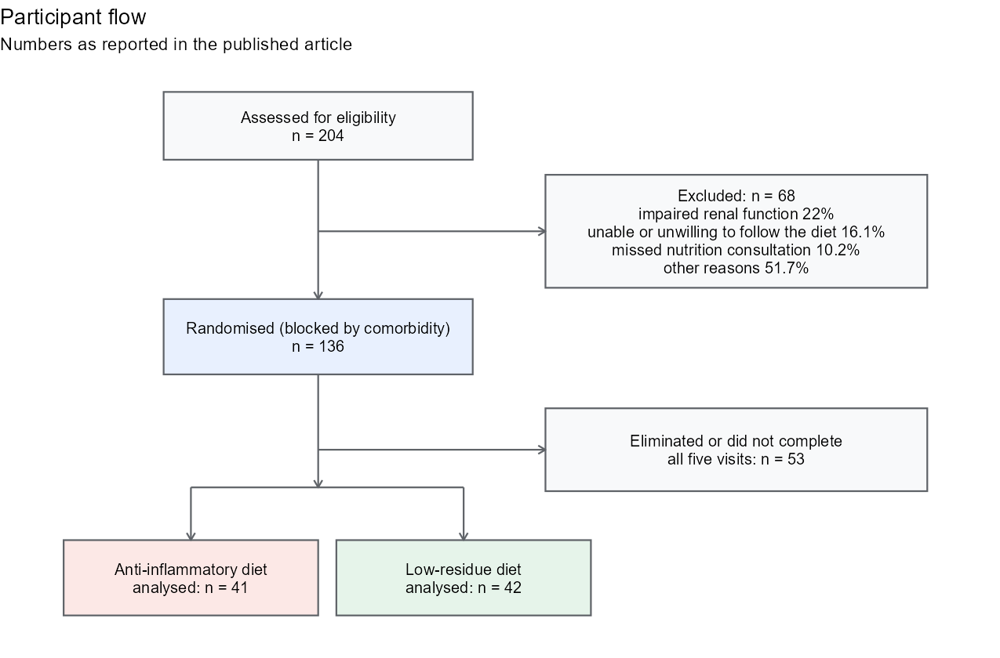
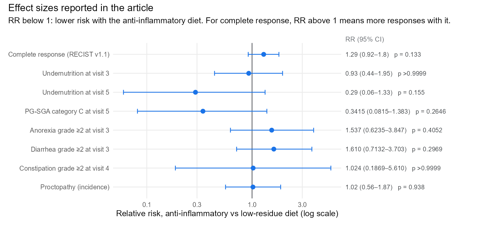

# Anti-inflammatory vs low-residue diet during chemoradiotherapy for cervical cancer

**Statistical analysis of a randomised controlled trial (NCT03994055), published in *Frontiers in Nutrition* 2026.**

📊 [Full report](https://amaugomez.github.io/cervical-cancer-diet-rct/) · 📄 [Article (open access)](https://doi.org/10.3389/fnut.2026.1835417)

Luvián-Morales J, *et al.*, **Gómez-Jiménez AM**, *et al.* Benefits of an anti-inflammatory diet compared to a low-residue diet during concurrent chemoradiation therapy for patients with locally advanced cervical cancer: a randomized clinical trial. *Front Nutr* 2026; 13: 1835417.

---

## At a glance

| | |
|---|---|
| **Design** | Two-arm randomised controlled trial with blocked randomisation, Instituto Nacional de Cancerología (INCan), Mexico City, 2018–2024 |
| **Participants** | 136 women with locally advanced cervical cancer randomised; 83 completed all five visits |
| **Comparison** | Individualised anti-inflammatory diet vs low-residue diet during chemoradiotherapy |
| **Main results** | Both arms recovered nutritionally; the anti-inflammatory diet tended to do better (complete tumour response 70.7% vs 54.8%, RR 1.29, 95% CI 0.92–1.8, p = 0.133) and showed more stable intestinal inflammation |
| **My role** | Credited with data curation and formal analysis. I directed the statistical analysis: choice of methods for each outcome, multiple imputation (MICE, 35 datasets) with Rubin's rules and its sensitivity analysis, relative risks and Hodges–Lehmann effect sizes, review of every model including the per-protocol and intention-to-treat analyses, and the statistical responses across two rounds of peer review |





All results above are as published.

## The statistical workflow

1. **Attrition:** compare completers and non-completers; per-protocol and intention-to-treat models.
2. **Missing data:** MICE with predictive mean matching, 35 imputations, 15 iterations.
3. **Pooling:** Rubin's rules for parametric models; median p-value across imputations for rank tests.
4. **Effect sizes:** relative risks and Hodges–Lehmann median differences with 95% CIs.
5. **Repeated measures:** linear mixed models with a time-by-diet interaction.
6. **Time to event:** Kaplan–Meier, log-rank and Cox regression.

## Reproduce it

The patient data are not public, so `run_all.R` runs the workflow on **simulated data** with the trial's structure. Its output only shows that the code runs; it is not the trial's result.

```r
Rscript run_all.R
```

| Script | What it does |
|---|---|
| `R/01_published_figures.R` | Participant flow and effect-size figures, from published numbers only |
| `R/02_simulate_trial.R` | Simulated trial: blocked randomisation, five visits, dropout, survival |
| `R/03_analysis.R` | The analysis workflow above |

Published numbers are in `results/published/`.

## Skills shown

Randomised controlled trials · intention-to-treat and per-protocol analysis · multiple imputation and Rubin's rules · non-parametric effect sizes · mixed-effects models · survival analysis · R · Quarto

---

Code: MIT License. Published results reproduced from the open-access article (CC BY 4.0).
Aaron Mauricio Gómez Jiménez · [LinkedIn](https://www.linkedin.com/in/amaugomezjimenez) · [ORCID](https://orcid.org/0009-0003-1099-0431)
