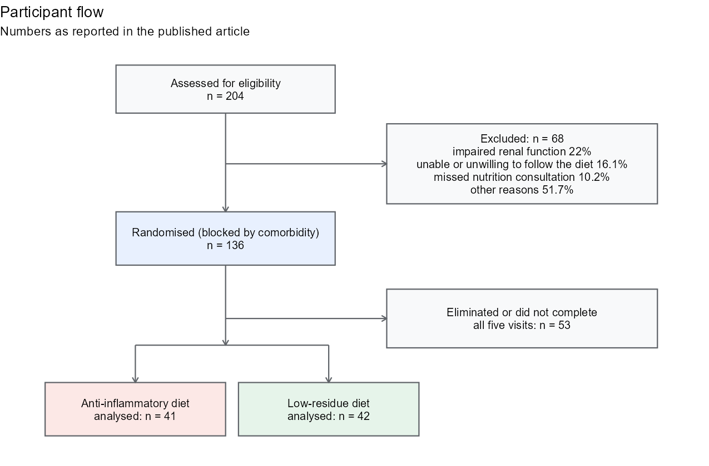
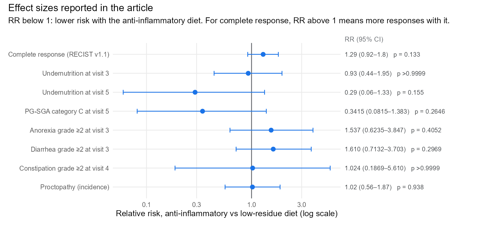

```{r}
#| include: false
library(readr); library(dplyr); library(knitr)
rd <- function(f) read_csv(file.path("results/published", f), show_col_types = FALSE,
                           col_types = cols(.default = col_character()))
key <- rd("key_results.csv"); t1 <- rd("baseline_table1.csv"); att <- rd("attrition.csv")
```

**Article:** Luvián-Morales J, Rueda-Escalona AA, Delgadillo-González M, Cetina-Pérez LC, Villalpando-Sánchez DC, **Gómez-Jiménez AM**, Rodríguez-Moreno MI, Medina-Contreras O, Castro-Eguiluz D. *Frontiers in Nutrition* 2026; 13: 1835417. [doi:10.3389/fnut.2026.1835417](https://doi.org/10.3389/fnut.2026.1835417) (open access) · Trial registration [NCT03994055](https://clinicaltrials.gov/study/NCT03994055) · [Code on GitHub](https://github.com/AMauGomez/cervical-cancer-diet-rct)

**Skills shown:** randomised controlled trials · intention-to-treat vs per-protocol analysis · multiple imputation and Rubin's rules · mixed models for repeated measures · survival analysis · effect sizes with confidence intervals

Every number on this page is taken from the published article.

```{=html}
<style>
.flow{display:flex;flex-wrap:wrap;gap:.6rem;margin:1.2rem 0 .4rem;align-items:stretch}
.flow .step{flex:1 1 150px;border:1px solid #dadce0;border-radius:10px;padding:.75rem .8rem;background:#fafbfc}
.flow .step .n{font-size:.72rem;letter-spacing:.06em;text-transform:uppercase;color:#5f6368}
.flow .step .big{font-size:1.35rem;font-weight:700;line-height:1.15;margin:.2rem 0}
.flow .step .txt{font-size:.85rem;color:#3c4043;line-height:1.3}
.flow .step.hl{border-color:#1a73e8;background:#e8f0fe}
.keybox{border-left:4px solid #1a73e8;background:#f8f9fa;padding:.8rem 1rem;margin:1rem 0;border-radius:4px}
.keybox ul{margin-bottom:0}
</style>
<div class="flow">
 <div class="step"><div class="n">Design</div><div class="big">RCT, 2 arms</div><div class="txt">blocked randomisation, National Cancer Institute (INCan), 2018–2024</div></div>
 <div class="step"><div class="n">Participants</div><div class="big">136 → 83</div><div class="txt">randomised → completed all five visits and analysed</div></div>
 <div class="step hl"><div class="n">Missing data</div><div class="big">35 imputations</div><div class="txt">MICE with predictive mean matching, pooled with Rubin's rules</div></div>
 <div class="step"><div class="n">Follow-up</div><div class="big">Up to 6 years</div><div class="txt">overall survival (median 44.4 months) and proctopathy by colonoscopy</div></div>
</div>
```

## Summary

**Question.** Women with locally advanced cervical cancer who receive chemoradiotherapy often develop gastrointestinal toxicity and undernutrition. The standard advice is a restrictive **low-residue diet** (low fibre, lactose and fat), although the evidence behind it is thin. Would an **anti-inflammatory diet**, rich in fibre, omega-3 fatty acids, antioxidants and probiotics, do better?

**Answer.** Both groups recovered nutritionally by three months after treatment. The anti-inflammatory diet **tended** to do better on nutritional recovery, persistent gastrointestinal symptoms and tumour response (complete response 70.7% vs 54.8%, RR 1.29, 95% CI 0.92–1.8, p = 0.133), but these differences were not statistically significant. The clearest differences were in inflammation: lower IL-1β and IL-17A, and faecal calprotectin that stayed stable instead of rising after treatment.

::: {.keybox}
**Why the statistics of this trial are not routine**

- **A wide dataset:** more than 50 outcomes per woman (diet, nutritional status and body composition, toxicity, cytokines, tumour response, survival and quality of life), measured at up to five visits, in a small sample. Every analytic choice multiplies across outcomes and visits.
- **Attrition:** 53 of 136 randomised women did not complete the five visits, and those who left were different (more advanced stage, more renal impairment). The analysis had to show that this did not drive the conclusions: per-protocol and intention-to-treat models, and a repeated-measures model on everyone with two CT scans.
- **Missing data:** multiple imputation (35 datasets), with Rubin's rules where they apply and a separate rule for rank tests where they do not, plus a sensitivity analysis.
- **Repeated measures:** five visits per woman, analysed with mixed-effects models and their time-by-diet interaction, not only visit-by-visit tests.
- **Honest effect sizes:** relative risks and Hodges–Lehmann median differences with 95% confidence intervals, and non-significant results reported as trends, not effects.
:::

## My role

I am credited with **data curation and formal analysis**, and I directed the statistical analysis of the trial:

- chose the statistical method for each outcome and reviewed every model, including the per-protocol and intention-to-treat analyses;
- designed and ran in R the missing-data strategy: multiple imputation by chained equations, pooling with Rubin's rules, and the sensitivity analysis of the imputations;
- computed the effect sizes (relative risks and Hodges–Lehmann median differences);
- wrote the statistical responses across two rounds of peer review.

The trial was designed and conducted by the clinical research team at the Instituto Nacional de Cancerología (INCan), Mexico City.

## Trial design

```{r}
#| fig-cap: "Participant flow, with the numbers reported in the article."

```

- **Participants:** women aged 18 or older with locally advanced cervical cancer (FIGO 2018 stages IB3 to IVA) starting chemoradiotherapy followed by brachytherapy as first-line treatment, ECOG 0–2.
- **Randomisation:** a pre-established list (randomization.org) in three blocks reflecting INCan's case mix: 40% without comorbidities, 30% with comorbidities and 30% with renal deterioration. Assignments were sent by a collaborator not involved in assessments; as the article notes, allocation concealment was not possible because of the nature of the intervention.
- **Interventions:** an individualised **anti-inflammatory diet** (30% of energy from fat; foods rich in anti-inflammatory compounds, soluble fibre and probiotics; green tea, chia seeds, ginger and turmeric provided) or an individualised **low-residue diet** (fibre ≤ 20 g, lactose ≤ 5 g, fat ≤ 20% of energy).
- **Visits:** V1 two weeks before chemoradiotherapy, V2 at its start, V3 after three cycles of chemotherapy, V4 after brachytherapy, V5 twelve weeks later.
- **Primary outcomes:** nutritional status and systemic inflammation. **Secondary:** gastrointestinal toxicity (CTCAE v5), intestinal inflammation (faecal calprotectin), tumour response (RECIST 1.1), proctopathy, overall survival and quality of life.
- **Sample size:** 130 women (two proportions of undernutrition, 81.4% vs 59.7%, α = 5%, power 80%). The target was not reached.

## Statistical approach

### Attrition: who left, and does it matter?

Of 136 randomised women, 83 completed the study. Those who did not were systematically different:

```{r}
att |>
  transmute(Characteristic = characteristic,
            `Did not complete` = ifelse(is.na(excluded), "", excluded),
            `Completed` = ifelse(is.na(included), "", included),
            Comparison = comparison) |>
  kable(caption = "Women who did not complete the study vs those analysed (as reported in the Results).")
```

A per-protocol analysis of the 83 completers can therefore be biased. Three analyses addressed it:

- a **multivariable model of malnutrition per protocol**, and the **same model by intention to treat**: in neither was the diet group independently associated with malnutrition (in the intention-to-treat model only comorbidities were);
- a **general linear model with repeated measures** of the muscle mass index from computed tomography, on the 48 + 55 randomised women with both an initial and a final scan: no time-by-diet interaction (p = 0.688). Treatment response (p = 0.016) and the use of a radiosensitiser (p = 0.045) were associated with the change, and the diet was not.

### Missing data: multiple imputation

Missing values were imputed with **multivariate imputation by chained equations (MICE)** and **predictive mean matching**, 15 iterations per chain and **35 imputed datasets**. How results were combined depended on the analysis:

- **parametric models:** Rubin's rules, averaging the estimates over the 35 datasets and combining within- and between-imputation variance, so the standard errors include the uncertainty due to missing data;
- **rank tests** (Mann–Whitney, Friedman), for which Rubin's rules do not apply: each test was run in all 35 datasets and the **median p-value** is reported.

A missing-data sensitivity analysis is reported in Supplementary Material 2 of the article.

### Repeated measures, effect sizes and survival

- **Within each diet over the five visits:** Friedman test (continuous) and Cochran's Q (categorical). **Between diets at each visit:** Mann–Whitney U and chi-squared or Fisher's exact test.
- **Mixed-effects models** for every longitudinal outcome, with fixed effects for time, diet and their interaction and a random effect for each woman. The interaction term is the one that tests whether the two diets diverge over time.
- **Effect sizes:** relative risks with 95% CIs for categorical outcomes; the **Hodges–Lehmann estimator** for median differences of non-normal continuous variables.
- **Time to event:** Kaplan–Meier curves and log-rank tests for proctopathy and overall survival, and Cox proportional-hazards models to adjust for clinical covariates.

## Results

### Baseline: randomisation produced comparable groups

```{r}
t1 |>
  transmute(Variable = variable, `All (n = 83)` = all_n83, `Anti-inflammatory (n = 41)` = AID_n41,
            `Low-residue (n = 42)` = LRD_n42,
            `Difference (95% CI)` = ifelse(is.na(difference_95ci), "", difference_95ci), p) |>
  kable(caption = "Selected rows of the published Table 1. Differences: Hodges–Lehmann estimator; p: Mann–Whitney U, chi-squared or Fisher's exact test.")
```

### Main outcomes

```{r}
key |>
  transmute(Outcome = outcome, `Anti-inflammatory diet` = AID, `Low-residue diet` = LRD,
            `Comparison` = ifelse(is.na(comparison), "", comparison)) |>
  kable(caption = "Main results as reported in the article. PG-SGA: Patient-Generated Subjective Global Assessment (B or C = at nutritional risk).")
```

```{r}
#| fig-cap: "Relative risks reported in the article, with 95% confidence intervals."

```

- **Nutrition:** undernutrition peaked at visit 3 in both arms and improved by visit 5, when it was less frequent with the anti-inflammatory diet (RR 0.29, 95% CI 0.06–1.33, p = 0.155). Changes over time were significant in both arms.
- **Inflammation:** the low-residue group had higher IL-1β at visit 3 and higher IL-17A at visit 5. Faecal calprotectin stayed stable with the anti-inflammatory diet and rose again after treatment with the low-residue diet, with a significant time-by-diet interaction.
- **Survival:** over a median follow-up of 44.4 months, 8 women (19.5%) died in the anti-inflammatory arm and 13 (31%) in the low-residue arm (log-rank p = 0.152). In the bivariate Cox model the low-residue diet was associated with higher mortality (HR 3.181, 95% CI 1.025–9.869, p = 0.045), but not after adjustment. Response to treatment remained independently associated with mortality, with the highest risk for disease progression (HR 18.773, 95% CI 4.914–71.717).

## Limitations stated in the article

- **Sample size:** the calculated 130 participants was not reached and withdrawal exceeded 20%, reducing statistical power.
- **Outcome-related exclusions:** some women were excluded for malnutrition, unmanageable toxicity or disease progression, which may bias the per-protocol comparison.
- **Adherence and lifestyle:** adherence was measured with 24-hour recalls without a biomarker; physical activity was not assessed; the COVID-19 pandemic may have affected food choices.

## If I ran the next trial

This trial was run in a real clinical setting, through the COVID-19 pandemic, with patients undergoing aggressive treatment. These are the statistical choices I would build into the protocol of the next one, at the design stage, where they cost least:

1. **Define the estimand first** (ICH E9(R1)). Hospitalisation with nutritional support, unmanageable toxicity and disease progression are *intercurrent events*. Deciding in advance how each is handled, for example with a treatment-policy strategy, turns post-randomisation exclusions into a planned part of the analysis.
2. **One prespecified primary analysis on everyone randomised.** For a primary outcome measured at five visits, a single mixed model for repeated measures with a time-by-diet contrast, by intention to treat, instead of a test at each visit.
3. **Plan the sample size for dropout.** Inflating the target for attrition like the one seen here (53 of 136 randomised) protects the power the design calls for.
4. **Test what happens if data are missing not at random.** Delta-adjusted multiple imputation (a tipping-point analysis) shows how far the imputed values of women who dropped out must shift before the conclusion changes.
5. **Pool non-parametric results formally.** Combine test statistics across imputations (the D2 rule) or use semi-parametric models, such as proportional-odds regression, that pool directly with Rubin's rules.
6. **Control multiplicity.** A fixed testing hierarchy for the primary outcomes, and secondary outcomes such as the cytokine panel reported as exploratory or with false-discovery-rate control.
7. **Adjust for the randomisation strata** (comorbidity blocks) in the primary model, as recommended for stratified designs.

## Code

The patient data are not public. The repository contains the analysis workflow in R, run on **simulated data** with the trial's structure (136 women randomised in blocks, five visits, dropout related to baseline risk, survival with censoring):

1. comparison of completers and non-completers (relative risks);
2. MICE with predictive mean matching, 35 imputations and 15 iterations;
3. Rubin's rules for parametric models and the median p-value for rank tests;
4. relative risks and Hodges–Lehmann median differences;
5. a linear mixed model with a likelihood-ratio test of the time-by-diet interaction;
6. Kaplan–Meier, log-rank test and Cox regression;
7. the same model per protocol and by intention to treat with imputation.

The simulated output only shows that the code runs; it is not the trial's result, so none of it appears on this page.

```bash
Rscript run_all.R   # about a minute
```

## How to cite

```bibtex
@article{luvianmorales2026diet,
  author  = {Luvián-Morales, Julissa and Rueda-Escalona, Ariadna Alejandra and Delgadillo-González, Merari and
             Cetina-Pérez, Lucely del Carmen and Villalpando-Sánchez, Diana Carolina and Gómez-Jiménez, Aaron Mauricio and
             Rodríguez-Moreno, Marcos Isaac and Medina-Contreras, Oscar and Castro-Eguiluz, Denisse},
  title   = {Benefits of an anti-inflammatory diet compared to a low-residue diet during concurrent
             chemoradiation therapy for patients with locally advanced cervical cancer: a randomized clinical trial},
  journal = {Frontiers in Nutrition},
  year    = {2026},
  volume  = {13},
  pages   = {1835417},
  doi     = {10.3389/fnut.2026.1835417}
}
```

Study details and results are reproduced from the open-access article (CC BY 4.0).
